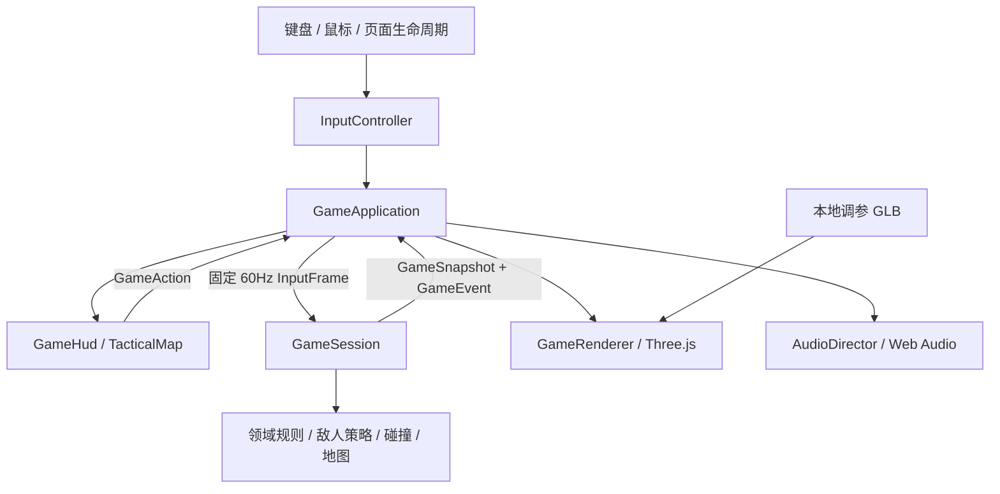
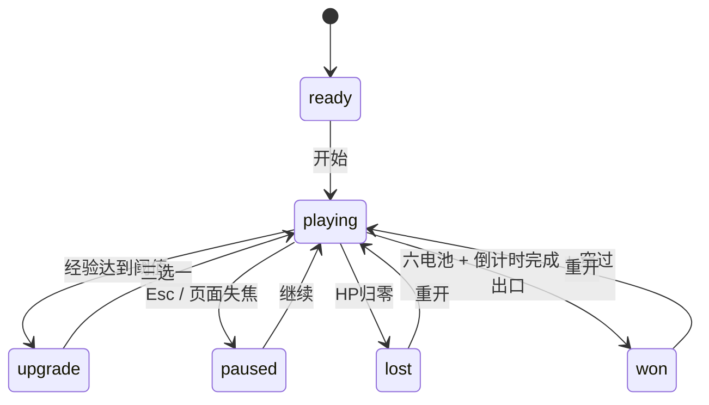

# 后续开发交接：深层巢穴 MVP

## 1. 先读这些文件

1. `design-v3.md`：玩法与已确认数值的原始依据。不要用本文件覆盖策划。
2. `music-design.md`：正式音频制作规格。
3. `assets-tuned/TUNING.md`：本地模型已经烘焙的缩放、色彩和缺失动画。
4. `src/contracts.ts`：领域、渲染、音频与界面的共享契约。
5. `src/domain/GameSession.ts`、`src/domain/config.ts`：游戏用例入口和数值。
6. `src/app/GameApplication.ts`：浏览器生命周期、输入采样、固定步长与事件分发。

本交付是桌面键鼠单人游戏，不是联网服务器、编辑器或移动端双摇杆实现。不要把“可在小屏显示”理解为触屏操作已经实现。

## 2. 运行与验证

```sh
pnpm install
pnpm dev
# http://127.0.0.1:5173

pnpm check
pnpm test
pnpm build
pnpm preview
```

- 包管理器用 pnpm，提交锁文件，不混用 npm/yarn。
- 本地 `assets-tuned/*.glb` 是运行与构建输入。资源不存在时应该修复资源，不要悄悄回退成方块。
- 模型由 Vite 打包为本地 URL，不依赖实时 Polyfork/CDN 请求。
- `window.__hiveDiagnostics()` 只返回诊断值；不暴露可修改的游戏会话，不提供通关作弊接口。
- 修改行为后运行领域测试；修改界面或渲染后还要打开真实浏览器。单纯 `tsc` 不能证明 WebGL 画面和交互正确。

## 3. 边界与依赖



### 领域约束

- `GameSession` 是一局游戏的聚合边界：死亡、升级、经济和撤离必须通过它进入，不让 HUD 直接加钱、扣血或收电池。
- `GameAction` 用于离散菜单命令；`InputFrame` 用于持续输入与单次操作。
- 快照作为观察接口使用，不允许渲染层、音频层、界面层回写。当前契约中的数组并不是深冻结对象；不要把类型上的可写性当成修改授权。
- 同一批事件先取出一次，再交给渲染和音频。不能让两个消费者分别 `drainEvents()`，否则第二个消费者收不到事件。
- 坐标采用 X/Z 地面、Y 高度，角度为 `atan2(dx, dz)`，零角朝 +Z。
- `GameApplication` 使用固定 1/60 秒步长；每帧累计真实时间并设上限，避免从后台恢复时补跑数分钟。冲刺、交互等单次按键仅在第一个模拟步消费。
- 失焦或隐藏标签页会清除输入并暂停，避免回到页面时仍在开火或移动。恢复必须由用户主动操作。



商店不是安全区，不暂停世界，也不提供无敌。撤离闸门是独立状态机：`locked → opening → open`；打开并不等于通关，玩家还需要穿过出口。

## 4. 策划歧义的落地选择

| 原策划中的歧义 / 缺失 | MVP 的选择 | 后续修改原则 |
|---|---|---|
| 六块中一块是假，但胜利要求六块真电池 | 六块真实目标之外增加假电池寄居蟹 | 真目标总数不可低于通关条件 |
| 电池分布仍为提案 | 两块探索拾取、三块蚁后精英守卫、一块沙虫掉落 | 改地图时一起校验目标可达性 |
| 月光水母替换待确认 | 使用本地非人形 `moon-jellyfish-0fa43c` | 不引入女性幽灵等人形敌人 |
| GLB 无攻击、死亡动画 | 程序化转向、突进、倒地及断肢反馈 | 更换动画时不能改变领域攻击窗口 |
| 暂无正式配乐和拟音文件 | 自制 Web Audio 合成循环与拟音，提供外部音频替换边界 | 正式素材替换声音，不重写游戏状态判定 |
| 缺少 CC0 地面贴图与参考图二进制 | 程序化工业地面、墙面与污渍，使用现有本地 GLB | 资产补齐后沿用相同尺寸、碰撞和光照约定 |

数值取自策划的 v1；“12–18 分钟一局、约 4,100 金币”是平衡目标，不是已通过玩家样本验证的结论。不要为满足时长直接把所有敌人血量或刷新率乘同一个任意系数。

## 5. 渲染与美术约束

- Three.js 斜俯视，不改成纯俯视，也不默认加入 PSX 像素化。
- 冷灰工业底色；绿为目标与电池，荧光体液为活物，红为警报和伤害。战斗可读性优先，但不能把整张巢穴照成白天。
- 手电跟随瞄准，开枪短暂照亮环境；拔电池改变电网与可见度。
- 本地 GLB 已经烘焙大小和颜色，不要再按最早 `assets/ASSETS.md` 的原始比例二次缩放。
- 骨骼模型实例必须独立克隆骨架，再绑定自己的 `AnimationMixer`。不能用普通 `Object3D.clone()` 共享同一个动画骨架。
- 道具视觉和碰撞分开定义：新增实体障碍物必须同时配置碰撞；纯装饰不能挡住必经路线。
- 模型攻击/死亡片段不足，不要拿移动动画是否结束作为伤害结算依据。
- 尸体保留；短期粒子必须回收。后续扩大地图时先做尸体批处理、远处动画休眠与空间索引，不要先删除尸体以掩盖性能问题。
- 不把备用章鱼、备用织网蛛或所有地表楼宇强塞进地下地图；素材库存不等于必须出场清单。

## 6. 音频接入约束

- 必须在用户点击后解锁 `AudioContext`。不要依赖自动播放许可。
- 分别控制音乐、音效、环境声及总静音；保留动态范围与压限，避免突然爆音。
- 状态来自快照，瞬时音来自领域事件；不能让每个 UI 组件各建一套音频上下文。
- 空间声音以玩家为听者，考虑距离、方位和墙体遮挡；声音信息不能穿过任意距离保持相同音量。
- 正式 stems 需同 BPM、同调性、同步循环点。目标 90 BPM，状态切换采用增益交叉淡化，不是每次从头播放另一首曲子。
- 深层探索应更安静；不要把危险程度简单映射为“所有轨道越来越响”。
- 合成版是实际可听的 MVP 配乐，不等于需求书中约 220 条经过审音的正式音频已经制作完毕。
- 正式音频预算、编码格式、许可来源和响度验收以 `music-design.md` 为准。文件加载成功不能代替耳机实听验收。

## 7. 后续 Agent 如何扩展

### 新增敌人

1. 先定义它解决的战斗问题、感知规则、状态转换、攻击预警和反制窗口。
2. 在 `EnemyKind`、数值表和行为策略中接入；复用移动、碰撞、受伤和奖励流程，禁止复制整套更新循环。
3. 提供模型映射、骨骼克隆、移动与程序化攻击动作、死亡残留、光照下轮廓。
4. 为预警、攻击、受击补入声音；静默怪必须是有意的行为规则。
5. 放进地图或导演生成池，证明正常游玩可遇见。
6. 测试面向玩家的机制，例如“鳗鱼缩回时子弹无伤”“断角之后不会再次冲锋”，而不是只断言注册表有一个键。

### 新增武器或升级

1. 从 `config.ts` 的配置扩展，复用射击 / 弹药 / 商店流程。
2. 同时接入 UI、模型挂点、枪声、枪口火光、噪音半径、购买与切换。
3. 检查弹匣、备弹、换弹中切换、零金币购买、重复独特项、叠层上限。
4. 改收益时一起检查击杀、处决、环境杀和连杀倍率，避免某一种击杀路径重复发奖励。

### 修改地图

1. 保持出生点、商店、大门、两块可探索电池、三块精英电池与 Boss 路线连通。
2. 主通路宽度要能容纳玩家与大体型敌人；不要只检查地图上“看起来有缝”。
3. 保持门两侧可操作；关闭的门可被敌人破坏，不得形成永久软锁。
4. 击杀守卫后确认电池变为可拾取，掉落位置不在墙内。
5. 闸门开启后出口必须可穿过，且没有未打开的大门碰撞残留。

### 推荐分工

| 边界 | 可以独立推进的工作 | 共享契约协调点 |
|---|---|---|
| 领域 / 平衡 | 敌人行为、成长、经济、导演生成 | `contracts.ts`、配置与事件语义 |
| 渲染 / 美术 | 动画、贴图、特效、遮挡、性能 | 模型 ID、状态、部位信息 |
| 音频 | 正式素材、混音、空间感与动态配乐 | 事件、音乐状态、加载预算 |
| 地图 / 关卡 | 路线、遭遇、地标、环境互动 | 碰撞、守卫、电池与出口 |
| UI / 可访问性 | 键位、反馈、菜单、屏幕尺寸 | 动作命令，不回写领域 |

修改共享契约时指定一个集成负责人，先迁移全部调用者再删旧字段；不要留下旧字段 alias、空策略或“以后再实现”的注册项。

## 8. 验收清单

- [ ] 首次进入没有模型 404、WebGL 错误或未处理 Promise。
- [ ] 键鼠移动、瞄准、开火、换弹、冲刺，失焦后不会粘键。
- [ ] 杀怪获得奖励，三选一能选择并恢复战斗。
- [ ] 商店扣款、换枪、消音、消耗品有实际效果；商店内仍会受伤。
- [ ] 各敌人的状态、反制窗口和断肢结果可见且有声音信息。
- [ ] 真实六电池可全部获得，假电池不计入胜利目标。
- [ ] 灯光、怪物强度、音乐随回收进度改变。
- [ ] 开门倒计时不会受慢动作延长，出口在开启前不能触发胜利。
- [ ] 死亡 / 通关能结算并重开，旧实体与旧事件不会污染下一局。
- [ ] 三路音量、静音、暂停与恢复符合浏览器手势限制。
- [ ] 生产构建通过本地预览打开，不依赖开发服务器的资源路径特例。

具体本次验证结果另见本文末尾的交付验证记录；这里的清单用于每次迭代，不代表每一项都已通过人工整局测试。

## 9. 本次交付的实际实现索引

| 文件 / 类 | 已落地的职责 |
|---|---|
| `src/domain/GameSession.ts` | 开始、暂停、恢复、重开、动作入口与事件取出 |
| `src/domain/Run.ts` | 一局聚合，区分真实时间与慢动作世界时间 |
| `src/domain/World.ts` | 80×80 地图、16 个房间 / 通道区域、栅格碰撞、线段遮挡、流场寻路 |
| `src/domain/PlayerController.ts` | 移动、冲刺、换弹、五枪切换与购买、消音器、补给 |
| `src/domain/Combat.ts` | 高速子弹线段检测，最近的墙 / 门 / 道具 / 敌人截获子弹，霰弹与火箭，处决 |
| `src/domain/Damage.ts` | 护甲、部位血量、断肢效果、击退、实际伤害事件、死亡与单次奖励 |
| `src/domain/Enemies.ts` | 完整 21 个敌人种类 / 变体的行为分派与状态转换 |
| `src/domain/Environment.ts` | 油桶、导电水面、连锁电击、酸池引燃、防火门、金币箱 |
| `src/domain/Director.ts` | 固定遭遇、区域刷怪、进度强化、精英与撤离围攻 |
| `src/domain/Objectives.ts` | 两块探索电池、三个巢母守卫、双 Boss、假电池、安装与撤离 |
| `src/domain/Progression.ts` | 经验、加权不重复三选一、层数限制、拾取、连杀与肾上腺素 |
| `src/render/AssetLibrary.ts` | 本地模型 URL、并行加载、独立骨架 / 材质克隆与释放 |
| `src/render/ActorView.ts` | 动画、右手挂枪、后坐、跳扑 / 俯冲表现、受击闪白、断肢骨骼缩放、尸体 |
| `src/render/World.ts` / `SceneObjects.ts` | 地面 / 墙体、分区灯、补给 / 闸门、道具 / 电池 / 危险区域 |
| `src/render/Lighting.ts` / `MaterialEffects.ts` | 手电、阴影、火光、断电、近景墙遮挡处理、夜视轮廓 |
| `src/render/CombatEffects.ts` / `ImpactOverlay.ts` | 粒子池、弹道、弹壳色碎粒、持久血迹、实际伤害数字与处决文字 |
| `src/audio/AudioDirector.ts` | 解锁、一次性合成、状态驱动混音、暂停 / 恢复、资源生命周期 |
| `src/audio/MusicScore.ts` | 六个基础 stem 与暖垫 / Boss / 狂暴替代层，90 BPM 同步循环 |
| `src/audio/Soundscape.ts` / `SpatialPlayer.ts` | 环境循环、方位心跳、距离衰减、墙 / 关闭门低通、声部上限 |
| `src/audio/ActionRecipes.ts` / `SystemRecipes.ts` | 五枪 / 消音 / 换弹、所有怪物的合成拟音与系统反馈 |
| `src/ui/GameHud.ts` | 中文 HUD、商店、三选一、暂停、结算、Boss 血量与可攻击窗口提示 |

### 敌人行为定位

`Enemies.behaviors` 是统一分派入口；新增规则优先复用移动、感知、接触伤害和导演生成，不复制整个更新方法。

| 类别 | 当前行为 |
|---|---|
| 巢虫 / 蝠群 | 追逐与群体接触压迫 |
| 酸爆蚜 / 寄生变体 | 自爆预警与酸池；贴身吸血、冲刺脱附 |
| 掘地蜈蚣 | S 形行进，中段 / 侧向部位破坏后分裂 |
| 蚁后 / 卵囊 | 守卫电池，定期产卵，靠近或受击后孵化 |
| 跳蛛 / 尸蛛 | 蓄力跳扑、断腹取消；背对两秒后从装死起身 |
| 毒蜂 | 保持距离发射毒刺，断翼后转地面追逐 |
| 螳螂 | 三米拟态伏击，断臂缩短攻击范围、降低伤害 |
| 横行蟹 | 侧向移动、正面减伤、断腿减速并破坏壳防御 |
| 锹甲 | 锁定位置后直线冲锋，撞墙硬直，断角取消冲锋 |
| 迅猛龙 | 成组布置，绕向玩家两侧包抄 |
| 人面蛾 | 平时盘旋，玩家换弹时俯冲 |
| 食尸兽 | 依枪声记忆位置追踪，而不是套用普通视觉追逐 |
| 水母 | 漂浮、近距离电击与电流提示 |
| 假电池寄居蟹 | 电池伪装，交互暴露，不减少六个真实目标 |
| 排水鳗 | 管内无敌 → 预警 → 突刺 → 无敌缩回 |
| 沙虫 | 潜地 → 两秒地面标记 → 三秒出土窗口；五电池提前唤醒 |
| 巨蛞蝓 | 缓慢推进、不吃硬直、留下减速黏液，控制深井入口 |

### 射击反馈契约

- `shot` 是开火事实，携带武器、位置、方向和消音状态；渲染和音效都消费同一事件。
- `hit.value` 必须是护甲结算后的真实伤害。浮字和击中甲壳的音效不显示未减伤的面板数值。
- `sever` / `kill` / `execute` 分开，处决反馈不意味着可以再发一次击杀奖励。
- 后坐和震动按武器区分，火箭 / 霰弹较强。系统开启 reduced motion 时关闭镜头震动。
- 第一次点击开始会等待合成音频就绪后才推进游戏，避免第一轮枪声丢失。
- 当前肢解采用骨骼缩放与粒子表现，不是运行时网格布尔切割；所有对应骨骼名已从本地 GLB 元数据检查。
- 击杀 / 处决有 35 / 65 ms 表现层 hit-stop：暂停提交 WebGL 新画面，不暂停领域模拟、输入或闸门计时。配合即时浮字、受击闪白、位移、碎粒、血迹和声响形成反馈。

## 10. 正式音频替换示例

在 `GameApplication` 创建音频导演时传入清单即可，路径对应放入 `public/audio/` 的授权 OGG 文件：

```ts
const audio = new AudioDirector({
  manifest: {
    loops: { drone: '/audio/drone.ogg', pulse: '/audio/pulse.ogg' },
    effects: { 'gun.pistol': '/audio/pistol.ogg', 'alert.worm': '/audio/worm-warning.ogg' },
  },
});
```

- 音乐循环长度为 90 BPM、4/4、4 小节，即 10⅔ 秒；环境循环为 8 秒。加载器校验循环长度。
- 外部文件必须同源且使用 `.ogg`；单条音效 150 KB、环境 500 KB、stem 2 MB、总编码文件 60 MB 预算。
- 单个替换加载失败会写入诊断错误，并保留已制作的合成声，不是以静音掩盖错误。
- `getDiagnostics()` 可查看当前音乐状态、上下文状态、活动循环、声部、替换错误和缓冲区大小。
- 合成版采用 22.05 kHz 单声道缓冲，定位由实时 StereoPanner 完成；正式交付的 44.1 kHz OGG 经浏览器解码。它是 MVP 的制作取舍，不是需求书最终母带规格。

## 11. 本次验证记录与边界

### 已执行

1. `pnpm test`：28 / 28 通过，约 0.22 秒。覆盖目标可达、六电池与撤离、死亡重开、换弹与换枪、购买、升级、护甲实际伤害、处决、断肢、寄生、尸蛛、蛾、鳗、沙虫窗口、环境杀、门碰撞、慢动作、霰弹散射与火箭范围伤害，以及蟹横移和断腹取消跳扑。
2. `pnpm build`：TypeScript 严格检查与 Vite 生产构建通过。
3. 通过生产预览而非开发服务器，在 Chromium 中执行真实键鼠输入：开始、等待音频就绪、射击击杀、弹药扣减、换弹补满、WASD 移动、E 打开补给终端、Esc 关闭 / 暂停、Tab 展开地图、静音切换、重开。
4. 浏览器诊断确认 43 个所需本地模型加载成功，无模型加载失败；运行时异常列表为空。音频进入 running / suspended 状态，19 个循环源建立，合成缓冲约 29.6 MB，无音频诊断错误。
5. 截图检查 1440×900 与 1280×720 两种桌面尺寸；后一尺寸没有水平溢出。实机发现并修复灯具白片、大门朝向及首轮射击音频尚未就绪的问题。
6. 最后一次代码修改后再次执行测试 / 构建，并在生产浏览器验证射击击杀、伤害浮字和音频就绪；运行时异常为零、404 请求为零。

### 不夸大的结论

- 没有宣称进行过 12–18 分钟完整人工通关。完整胜负链由确定性测试覆盖，浏览器覆盖启动与操作冒烟。
- 没有逐种敌人、逐把枪做完整人工视听验收。霰弹 / 火箭规则和伤害反馈有测试，浏览器实际观察了手枪命中浮字、弹道、击杀与尸体。
- 合成音频图、缓冲和状态切换已在浏览器运行；当前自动化环境没有替代戴耳机审音，正式混音仍需要实听。
- 28 个测试不是性能认证。敌人存活上限为普通 110、撤离 150；导演巡逻上限 30，每个巢穴子代上限 6；尸体仍保留。扩大单局怪量之前，优先测量骨骼与尸体开销。
- Vite 提示主 JS chunk 大于 500 KB；当前构建约 731 KB、gzip 约 201 KB，构建成功，未通过提高阈值隐藏警告。后续可按资源区域和 Three.js 边界拆包。
- 画风、程序化攻击和合成音频是可玩的 MVP 表现，不是最终美术 / 动画 / 拟音制作完成证明。

交接原则：后续开发应在此可运行闭环上做内容扩充、手感和平衡迭代，不再另起一套会话、输入、渲染或声音管理器。
